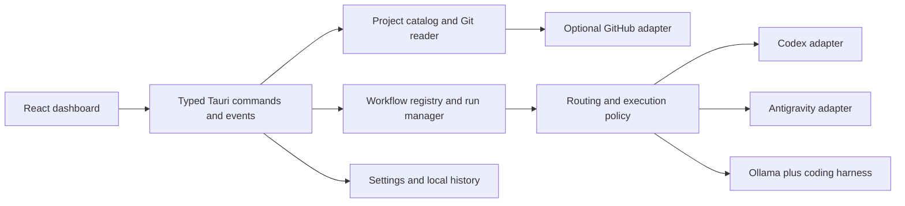

# Architecture and design context

Current implementation: the desktop app owns project discovery, settings and its native IPC bridge. The Tauri-independent `runner-core` crate owns local issue persistence, provider adapters, routing, budgets, jobs, isolation, verification and batch supervision; `fabrica-runner` and `fabrica-worker` use that same core. The frontend renders typed bounded results and cannot read raw provider credentials. Integrated runner acceptance remains in progress; [runner readiness](runner-readiness.md) records current evidence and gaps.

The diagrams and proposed contracts below retain the original design context. They are not evidence that every proposal has shipped.

The project-card Commit/Push dialog first displays changed paths from a display-only `git --no-optional-locks status --porcelain=v1 -z` call, before version preparation, full snapshot capture or drafting. The prepared review then refreshes that list with any version edits. Message and description remain editable during drafting; late results preserve edited fields, and disposed or started dialogs ignore late results. Confirmation requires a prepared fingerprint and a message, but can proceed with manual text while inference is pending. Optional drafting uses the direct Google Gemini Developer API model `gemini-3.5-flash-lite`, independently of the coding provider, with a 60-second timeout and bounded JSON response. The Rust backend reads the current user's `GEMINI_API_KEY` environment variable and sends it only in the HTTPS `x-goog-api-key` header; the key is not exposed to the frontend, settings, or logs. API or credential errors allow manual entry without provider/model fallback. Safe tracked excerpts use two batched literal-pathspec diff reads, retaining sensitive-path filtering and the context size bound. State validation retains the same complete fingerprint but skips rebuilding AI excerpts; the reviewed commit preflight and script still freshly validate repository state before effects. Confirmation launches the Fabrica-owned `src-tauri/scripts/commit-reviewed.ps1`, embedded in the desktop binary and materialized in private run storage. This script needs Git and Windows PowerShell, not an agent provider or installed skill. Native preflight pins the reviewed scope and repository snapshot; the script rechecks HEAD, branch, status, index, file contents and remote URL, preserves the approved message, fetches the exact remote branch, rebases local commits with merges preserved, pushes without force and verifies the resulting remote SHA. Before rebasing it requires a clean tree and saves the original tip under a unique local `refs/fabrica/before-push/` recovery ref. Existing Git operations and hook-created changes stop the workflow; autostash, automatic conflict resolution and updates to other branch refs are disabled. Conflicts leave the rebase in progress, list conflicted files and stop before push. Fetch, rebase, push and verification phases plus streamed Git/hook output appear in the same dialog. Push-only supports diverged branches and preserves existing commit messages without AI drafting. A rebase that changes prepared Tauri app content omits the stale version receipt. When GitHub explicitly rejects a direct push because changes require a PR (GH006/GH013), the confirmed workflow may publish the verified commit to a deterministic `codex/fabrica-push/<sha>` branch and create or reuse a PR against the original target using GitHub CLI. Publishing the fallback PR branch preserves the reviewed local branch and upstream. After verified merge completion, the script fetches the exact remote base and verifies it contains GitHub's merge commit before updating the reviewed base checkout. It rechecks branch, HEAD, upstream, clean index/worktree and in-progress Git operations; new local work causes sync to be skipped with a separate dialog status. Newly tracked remote paths are also checked against existing local paths so ignored build/cache files are preserved. A recovery ref saves the published tip before any local update. Merge commits fast-forward; squash/rebase merges align through a zero-commit rebase from the pinned published tip with autostash and other-ref updates disabled, without hard resets. The workflow never switches another checkout or updates a different local branch. Successful sync requires matching local/remote-tracking heads and a clean tree. Queued auto-merges are polled within the existing run budget so local sync follows observed merge completion; if that budget expires first, the dialog explicitly reports local sync pending. Version push receipts are recorded at verified branch publication before merge/sync changes local HEAD. Other rejection types stop without this fallback. Branch publication and PR creation are checkpointed separately; ambiguous creation is reconciled by readback rather than repeated creation. PR title/body reuse the approved commit text, with the body passed through a UTF-8 file. The dialog shows the PR link, checks and a separate merge state. New reviewed Push confirmations explicitly permit automatic PR merging through a typed `autoMergePullRequest` flag; saved workflows default to false, and other agent runtimes cannot use this permission. The script pins the exact published head for every merge request and selects an enabled repository merge method. When GitHub auto-merge is enabled, it requests auto-merge and reads back either a queued request or a verified merge. Otherwise it waits in the running dialog for clean checks/review readiness, then performs a normal merge; failed checks, changed heads/targets, requested changes and conflicts stop the workflow. This fallback waits within a nine-minute total script budget, leaving time for the run manager's ten-minute timeout. Timeout or unavailable permissions preserve the PR for explicit retry. Completed merges require GitHub readback of merged state, timestamp and merge SHA; queued auto-merge is never presented as a completed merge. Ambiguous merge responses are reconciled by readback without another mutation. The workflow never uses administrator bypass or changes repository protection settings. GitHub CLI is needed only for this fallback. Git output has ANSI control sequences stripped. Existing Git hooks still run. The review dialog opens at its full size with loading placeholders, retains the reviewed fields during execution and streams commit/push output into its lower progress panel. Activity also records the operation and any completed effects; failed or interrupted operations are not automatically retried. For Tauri projects, a shared version helper prepares or reuses a bump before review so every managed version file is visible in the approved snapshot. Push verifies that preparation and records the remote SHA after readback. Push-only preserves already committed versions. This quick action does not run the broader dev-push skill's project verification workflow.

The Build action and build retry use the embedded `src-tauri/scripts/build_project.py` plus the shared version preparation helpers. They require Python 3.11+, Git and the selected project's package manager/Tauri toolchain, with no AI provider or installed skill. Release is the default; debug must be selected explicitly. The helper preserves dirty files and Git history, prepares or reuses one synchronized version, runs the declared build command, verifies the expected executable and configured NSIS installer metadata, checks isolated startup and records a content-bound receipt. Version state uses `FABRICA_VERSION_STATE_DIR` when configured, otherwise the sibling `versions` folder for the private desktop storage layout, or the app's `version-preparation` folder. Build intent text and repository side-effect permissions are not requested for scripted builds.

Routine project controls are deterministic: Pull and Main use the native Git adapter; Refresh uses the native scanner; Open folder uses the native folder launcher; both Commit/Push entry points share the bundled review/script workflow; Build and retries share the bundled build helper. AI remains available for message drafting, issue implementation and audits. Build opens a full-size dialog directly from the project card and from build/retry actions, showing live output and all six steps without navigation. Closing the dialog leaves the build running; the project-card Build button reopens its active run instead of launching a duplicate. Commit and Build dialogs share bounded event subscriptions and snapshot recovery. Build output also streams into Activity and run details, with six explicit phases (version preparation, build, artifact verification, startup check, receipt persistence and completion); these are step counts rather than percentage or ETA estimates.

## Boundaries

- React renders state, collects typed inputs, and observes events. No unrestricted shell, filesystem, credential, or provider endpoint access from the webview.
- Rust owns canonical path validation, scanning, Git facts, process lifecycle, credential references, settings, and durable run transitions. Add narrowly scoped IPC and capabilities per feature.
- GitHub enrichment is optional and cached independently from local discovery. Respect private repo visibility, auth, pagination, rate limits, and last-known freshness.
- Provider adapters normalize capabilities and run events. A user-configured executable is explicitly trusted; runtime arguments are an array, not interpolated shell text. Windows `.cmd`/`.ps1` entry points need a declared host and verified quoting contract.
- Workflow entries are versioned and project-aware. They include ID, skill reference or executable recipe, stack requirements, input schema, effect scope, timeout, checks, and expected artifacts.

## Proposed data contracts

Project: stable ID derived from canonical path; root; path; classification; Git metadata; normalized remotes; detected stack; local/remote freshness; partial errors. Handle `.git` directories and files, nested repos, worktrees, inaccessible folders, renamed paths, symlinks/junctions, and roots outside `C:\Projects`. Bound depth, excluded directories, concurrency, output, and cancellation. Never change safe.directory globally to suppress failures.

Run: ID; project/worktree; action; provider/model/runtime version; explicit effect scope; inputs; timestamps; state; sequence-numbered events; redacted logs; checkpoint; exit status; checks; artifacts. Allow one mutating run per repository/worktree by default. Persist before executing; checkpoint each completed side effect. After app restart mark orphaned work interrupted and reconcile process state before retry.

Provider: configured ID/type; display name; executable/endpoint; model profiles; capability flags; health/auth status; secret reference; privacy policy. Use no fixed model catalog. Probe explicitly, time out, and report unavailable fields honestly.

Usage signal: provider/model; measured or estimated value; unit (tokens, requests, money, percent, GPU memory); window; reset timestamp; collected timestamp; source; confidence. No inferred subscription balance from a single run's tokens.

Routing decision: task requirements; pace; eligible candidates; observed health/usage/latency; selected candidate; explanation; rejected-candidate reasons; override; checkpoint/fallback rule. Keep decisions reproducible with saved configuration versions.

## Persistence and execution

Use schema-versioned app settings with atomic writes. Add SQLite run/event history when run management ships, not during scaffolding. Keep generated logs, user paths, auth material, and job outputs outside Git. Apply bounded retention and redaction before logs are persisted/exported. Use Windows credential storage or provider-managed sessions, never scrape desktop tokens.

Before a mutating action: inspect selected repo, current branch, dirty state, auth, prerequisites, and dependencies. Offer an isolated worktree when appropriate; never auto-stash unrelated work. Pin operations to the verified canonical path. On Windows cancel the spawned process tree via managed lifecycle (evaluate Job Objects), not a broad process-name kill.

Proposed app events: project.scan-progress, project.updated, run.state-changed, run.output, run.needs-input, provider.health-changed, routing.decision. IPC inputs and events are typed, versioned, and bounded; UI handles disconnect/restart and partial failure.

## Verification targets

Use synthetic/temp repositories for scanner and mutation tests; provider contract fixtures for malformed streams, auth failure, stale usage, cancellation, and retry; live opt-in checks for installed adapters. Verify keyboard/reduced-motion behavior, no duplicate remote side effects, data retention, CSP/capabilities, and Windows paths with spaces. Provisional performance targets: render interactive in 2 seconds on a documented Windows machine, first scan results in 1 second for 100 direct child projects, full scan under 5 seconds on SSD, no synchronous scanning on the UI thread. Recalibrate with measured baselines; network enrichment never blocks local cards.

## Single-issue work

Work on issue opens from the local issue reader; project actions navigate to that reader. The former GitHub/dev-work prompt launcher is removed. A bounded native preparation command binds the current Markdown revision, canonical project/config/source paths, local Git baseline, explicit file scope, acceptance criteria and verification check to a single shared-runner batch with implementation and independent reviewer tasks. Initial single-issue routing uses the selected configured Codex provider/model, one attempt per task, a 400,000-token aggregate ceiling, a one-hour window and zero paid API budget. Epics, closed work and dependencies needing completion evidence are sent to the batch planner rather than inferred ready.

Preparation and preview launch no provider tasks. The user reviews the runner plan before submission; unavailable routes remain blocked. Opening or reviewing the dialog refreshes model-free local provider observations before preview; explicit provider refresh also rebuilds the preview. Dispatch may refresh model-free Codex facts without changing the selected provider or model. The Build-style dialog polls durable status/events with bounded output, exposes cancellation, saves the connection per issue for reopen, and links the exact batch to the existing recovery view. Unknown submit outcomes are retained for inspection without automatic retry or cancellation; only a confirmed submission or WORKER_LAUNCH_FAILED admits controls. Closing the dialog leaves admitted work with the shared runner. This integration does not change the runner-readiness acceptance record or prove detached worker lifetime.

The single-issue dialog automatically prepares its preview on open. Native inference uses the current authoritative issue, tracked file inventory, inline/structured file references and declared npm/Cargo verification recipes. Unless the issue declares a structured files scope, prose references are combined with conventional tracked application source roots, including frontend, native and shared runner code, shown in the expandable scope summary. Incidental helper references never become an exclusive write allowlist. It never executes commands extracted from issue prose. Unsupported layouts, unavailable tools, missing criteria or unbounded scope require an explicit Advanced override. Windows npm checks invoke the installed npm CLI through Node rather than a batch shell. Manual controls are collapsed by default; Start still requires an eligible preview and retains the existing submission/recovery binding.
