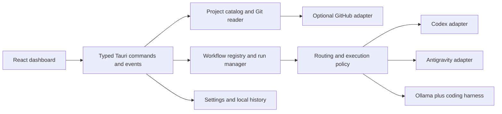

# Architecture and design context

Current implementation: the desktop app owns project discovery, settings and its native IPC bridge. The Tauri-independent `runner-core` crate owns local issue persistence, provider adapters, routing, budgets, jobs, isolation, verification and batch supervision; `fabrica-runner` and `fabrica-worker` use that same core. The frontend renders typed bounded results and cannot read raw provider credentials. Integrated runner acceptance remains in progress; [runner readiness](runner-readiness.md) records current evidence and gaps.

The diagrams and proposed contracts below retain the original design context. They are not evidence that every proposal has shipped.

## Boundaries

- React renders state, collects typed inputs, and observes events. No unrestricted shell, filesystem, credential, or provider endpoint access from the webview.
- Rust owns canonical path validation, scanning, Git facts, process lifecycle, credential references, settings, and durable run transitions. Add narrowly scoped IPC and capabilities per feature.
- GitHub enrichment is optional and cached independently from local discovery. Respect private repo visibility, auth, pagination, rate limits, and last-known freshness.
- Provider adapters normalize capabilities and run events. A user-configured executable is explicitly trusted; runtime arguments are an array, not interpolated shell text. Windows `.cmd`/`.ps1` entry points need a declared host and verified quoting contract.
- Workflow entries are versioned and project-aware. They include ID, skill reference or executable recipe, stack requirements, input schema, effect scope, timeout, checks, and expected artifacts.

## Proposed data contracts

Project: stable ID derived from canonical path; root; path; classification; Git metadata; normalized remotes; detected stack; local/remote freshness; partial errors. Handle `.git` directories and files, nested repos, worktrees, inaccessible folders, renamed paths, symlinks/junctions, and roots outside `C:\Projects`. Bound depth, excluded directories, concurrency, output, and cancellation. Never change safe.directory globally to suppress failures.

Run: ID; project/worktree; action; provider/model/runtime version; explicit effect scope; inputs; timestamps; state; sequence-numbered events; redacted logs; checkpoint; exit status; checks; artifacts. Allow one mutating run per repository/worktree by default. Persist before executing; checkpoint each completed side effect. After app restart mark orphaned work interrupted and reconcile process state before retry.

Provider: configured ID/type; display name; executable/endpoint; model profiles; capability flags; health/auth status; secret reference; privacy policy. Use no fixed model catalog. Probe explicitly, time out, and report unavailable fields honestly.

Usage signal: provider/model; measured or estimated value; unit (tokens, requests, money, percent, GPU memory); window; reset timestamp; collected timestamp; source; confidence. No inferred subscription balance from a single run's tokens.

Routing decision: task requirements; pace; eligible candidates; observed health/usage/latency; selected candidate; explanation; rejected-candidate reasons; override; checkpoint/fallback rule. Keep decisions reproducible with saved configuration versions.

## Persistence and execution

Use schema-versioned app settings with atomic writes. Add SQLite run/event history when run management ships, not during scaffolding. Keep generated logs, user paths, auth material, and job outputs outside Git. Apply bounded retention and redaction before logs are persisted/exported. Use Windows credential storage or provider-managed sessions, never scrape desktop tokens.

Before a mutating action: inspect selected repo, current branch, dirty state, auth, prerequisites, and dependencies. Offer an isolated worktree when appropriate; never auto-stash unrelated work. Pin operations to the verified canonical path. On Windows cancel the spawned process tree via managed lifecycle (evaluate Job Objects), not a broad process-name kill.

Proposed app events: project.scan-progress, project.updated, run.state-changed, run.output, run.needs-input, provider.health-changed, routing.decision. IPC inputs and events are typed, versioned, and bounded; UI handles disconnect/restart and partial failure.

## Verification targets

Use synthetic/temp repositories for scanner and mutation tests; provider contract fixtures for malformed streams, auth failure, stale usage, cancellation, and retry; live opt-in checks for installed adapters. Verify keyboard/reduced-motion behavior, no duplicate remote side effects, data retention, CSP/capabilities, and Windows paths with spaces. Provisional performance targets: render interactive in 2 seconds on a documented Windows machine, first scan results in 1 second for 100 direct child projects, full scan under 5 seconds on SSD, no synchronous scanning on the UI thread. Recalibrate with measured baselines; network enrichment never blocks local cards.
